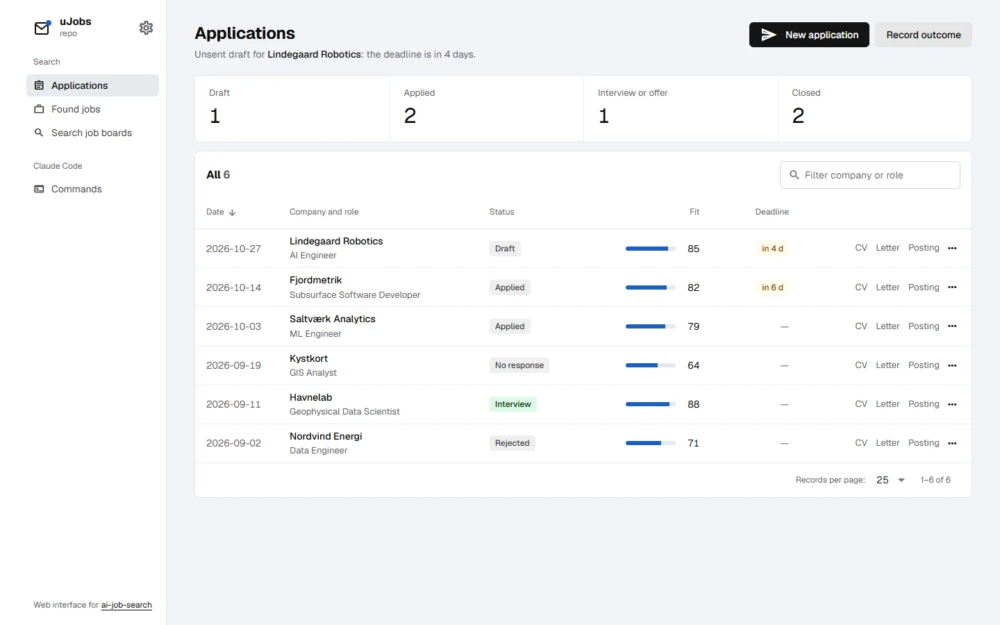
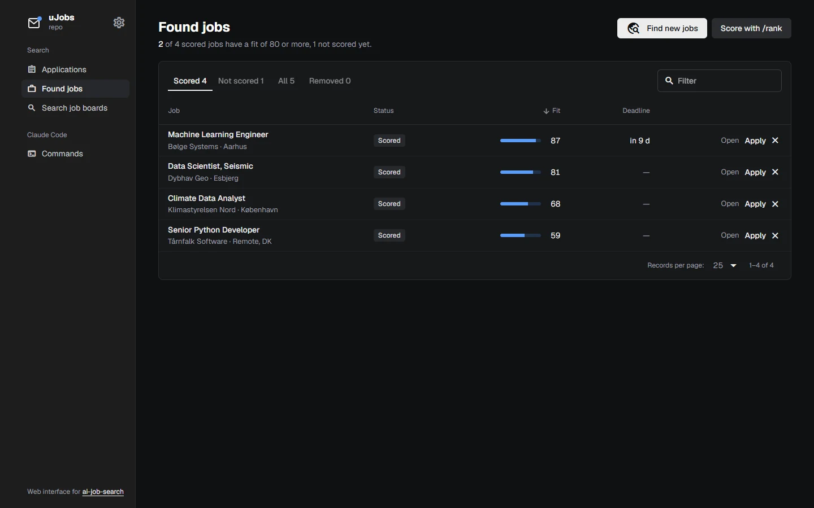
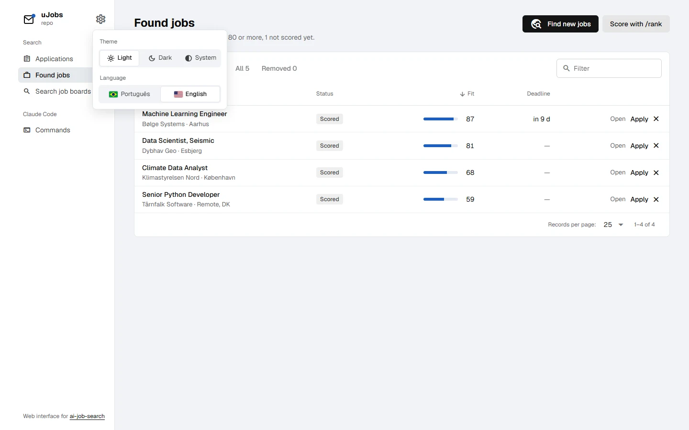
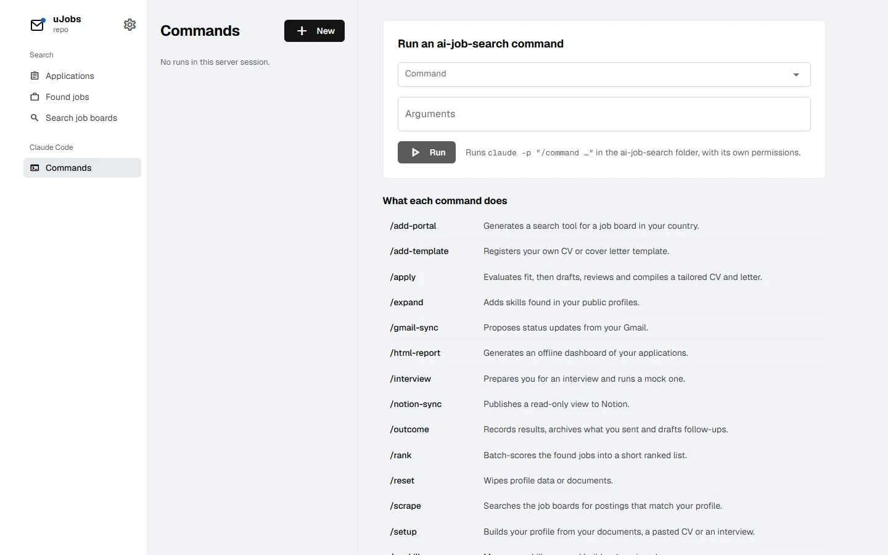
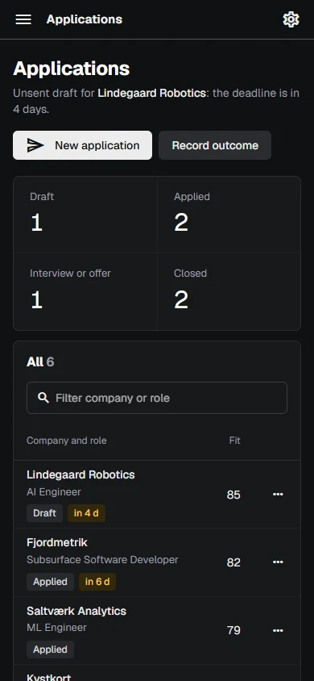

<p align="center">
  
</p>

<h1 align="center">uJobs</h1>

<p align="center">
  <b>English</b> · <a href="README.pt-BR.md">Português (Brasil)</a>
</p>

<p align="center">
  A web interface for <a href="https://github.com/ai-job-search-dev/ai-job-search">ai-job-search</a>: your applications, the jobs it found and its Claude Code commands, in one local page. One Go binary with the frontend inside, choosing Gin, Echo or Chi at startup.
</p>

<p align="center">
  
  
  
  
  
  
  
</p>

<p align="center">
  
</p>

> [!NOTE]
> **uJobs depends on ai-job-search and does none of its work.** Finding jobs, scoring them, writing the CV and the cover letter all happen in ai-job-search, run by Claude Code. uJobs reads the files it writes and starts its commands. Without an ai-job-search folder there is nothing to show. The screenshots use made-up sample companies.

## Features

- **Applications**: every row of `job_search_tracker.csv`, with how many sit in each stage, the fit score as a bar, deadlines a week out highlighted, links to the CV, letter and posting, and shortcuts to `/interview` and `/outcome`. The line under the title says what needs you first (an unsent draft whose deadline is close).
- **Found jobs**: the `/scrape` and `/rank` history from `job_scraper/seen_jobs.json`, in **Scored**, **Not scored**, **All** and **Removed** tabs, with an **Apply** button that starts `/apply`.
- **Remove from panel**: hides a job without deleting it. It is marked `skipped`, the status ai-job-search already uses for set-aside postings, so `/rank` ignores it and `/scrape` won't bring it back. Undo right away, or restore it from **Removed**.
- **Search job boards**: one search on one installed board, through ai-job-search's own search tools.
- **Commands**: runs any ai-job-search command (`/setup`, `/scrape`, `/apply <url>`…) with `claude -p`, and lets you answer Claude's questions in the same session.
- **Settings** (⚙ at the top): **light, dark or system theme** and **Portuguese or English**, both remembered.
- **Three backends, one API**: `--router gin`, `--router echo` or `--router chi`; the same test suite runs against all three.

## Screenshots

**Found jobs** in the dark theme.

<p align="center"></p>

**Settings**: theme and language.

<p align="center"></p>

**Commands**: every ai-job-search command with what it does.

<p align="center"></p>

**On a phone**, the navigation folds into a menu.

<p align="center"></p>

## Getting started

You need:

- an **ai-job-search folder already set up**, following its [SETUP.md](https://github.com/ai-job-search-dev/ai-job-search/blob/main/SETUP.md) (Claude Code, Bun, Python and LaTeX);
- **Go 1.26+** and **Node 22+**, only to build (an older Go from 1.21 on downloads 1.26 by itself).

```sh
git clone https://github.com/SamuelSchutz13/uJobsGUI.git
cd uJobsGUI

cd web && npm install && npm run build && cd ..
go build -o ujobs .

./ujobs --root /path/to/ai-job-search     # or AI_JOB_SEARCH_DIR=/path/to/ai-job-search ./ujobs
```

Open **http://127.0.0.1:8080**.

| Flag       | Default              | What it is                                   |
| ---------- | -------------------- | -------------------------------------------- |
| `--root`   | `$AI_JOB_SEARCH_DIR` | the ai-job-search folder                     |
| `--router` | `chi`                | `gin`, `echo` or `chi`                       |
| `--addr`   | `127.0.0.1:8080`     | listen address; keep it on loopback          |
| `--claude` | `claude`             | the Claude Code executable                   |
| `--bun`    | `bun`                | the Bun executable                           |

### Development

```sh
go run . --root ../ai-job-search     # API on :8080
cd web && npm run dev                # Quasar with hot reload, proxies /api to :8080
go test ./...                        # the same requests against Gin, Echo and Chi
```

## How it works

```
browser  →  Quasar app (embedded)  →  /api  →  Gin | Echo | Chi  →  internal/core
internal/core  →  job_search_tracker.csv, job_scraper/seen_jobs.json, cv/, cover_letters/
               →  bun run .agents/skills/<board>/cli/src/cli.ts search …
               →  claude -p "/<command> …"  (then --resume for replies)
```

- **One core, three routers.** All the logic sits in `internal/core`, which knows nothing about HTTP frameworks. `gin.go`, `echo.go` and `chi.go` each wire the same routes to it.
- **Nothing reimplemented.** Job data comes from the files ai-job-search writes; searches and commands run its own tools, in its folder, with its own `.claude/settings.json` permissions.
- **Careful writes.** Removing a job changes only that entry's `status` and replaces the file atomically, the same way ai-job-search's `rank_state.py` does.
- **Languages** live in `web/src/i18n.js`; switching also switches Quasar's own texts. Server errors arrive with a code (`unknown_command`, `portal_not_found`…) that the page shows in your language, with English as the fallback. **Theme and language** are remembered in the browser.

### Security

uJobs starts Claude Code with access to your personal data, so:

- it listens on `127.0.0.1` by default. **Do not expose it to a network.**
- requests whose `Host` is not loopback are refused (DNS rebinding), and writes must be `application/json`, so another website cannot start commands through your browser;
- it only runs commands that exist in the folder's `.claude/commands` and `.claude/skills`;
- `/files` serves only `cv/`, `cover_letters/` and `documents/applications/`.

### Project structure

```
main.go                   flags and startup
internal/
  core/core.go            reads the ai-job-search folder, runs its tools (no framework)
  api/api.go              routes, errors and security shared by every router
  api/gin.go              Gin adapter
  api/echo.go             Echo adapter
  api/chi.go              Chi adapter
  api/api_test.go         the same requests against all three
web/
  embed.go                embeds dist/spa in the binary
  public/favicon.svg      browser tab icon
  src/i18n.js             Portuguese and English texts
  src/Settings.vue        theme and language menu
  src/app.css             light and dark tokens
  src/pages/              Applications, Found jobs, Search, Commands
```

## Known limitations

- **Claude's reply arrives at the end.** There is no live progress while a command runs; `/apply` can take a few minutes.
- **Runs live in memory.** Restarting the server forgets the Commands list (the files ai-job-search wrote stay).
- **Restore** does not know the status a job had before it was removed: a scored job goes back to Scored, any other to the `/rank` queue. **Undo**, right after removing, restores it exactly.
- The job boards that ship with ai-job-search are mostly Danish, plus LinkedIn and Freehire. Use `/add-portal` in ai-job-search to add one for your country.

## Credits

- [ai-job-search](https://github.com/ai-job-search-dev/ai-job-search) by its authors (MIT), which does all the actual job search work. If it helped you, support it through the link in its README.
- Font: [Geist](https://vercel.com/font) (SIL Open Font License), loaded from Google Fonts.
- Icons: [Material Icons](https://fonts.google.com/icons) (Apache 2.0), through `@quasar/extras`.
- Look: the "achromatic ledger" style from [taste-skill](https://github.com/Leonxlnx/taste-skill).

uJobs is an independent community project, not affiliated with ai-job-search or Anthropic. MIT license.
