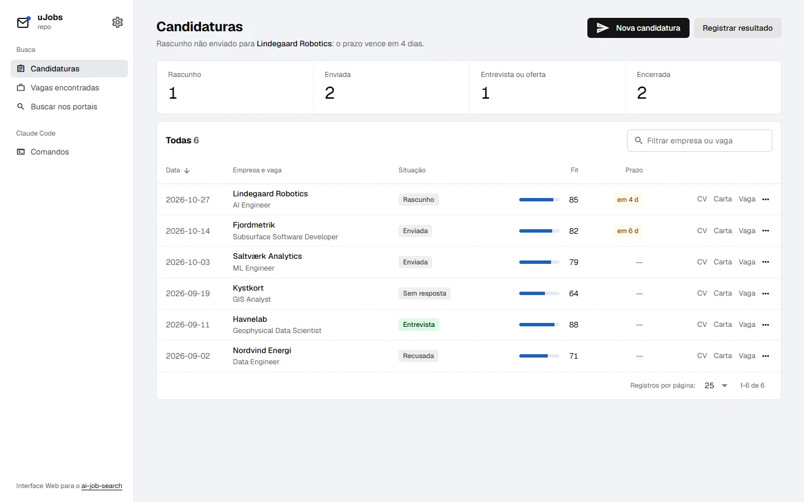
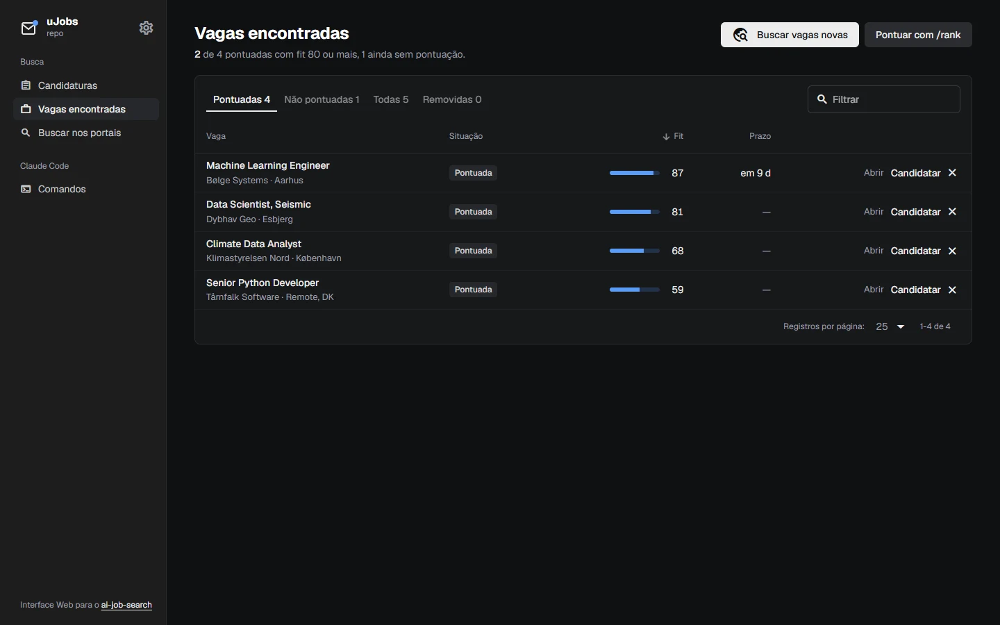
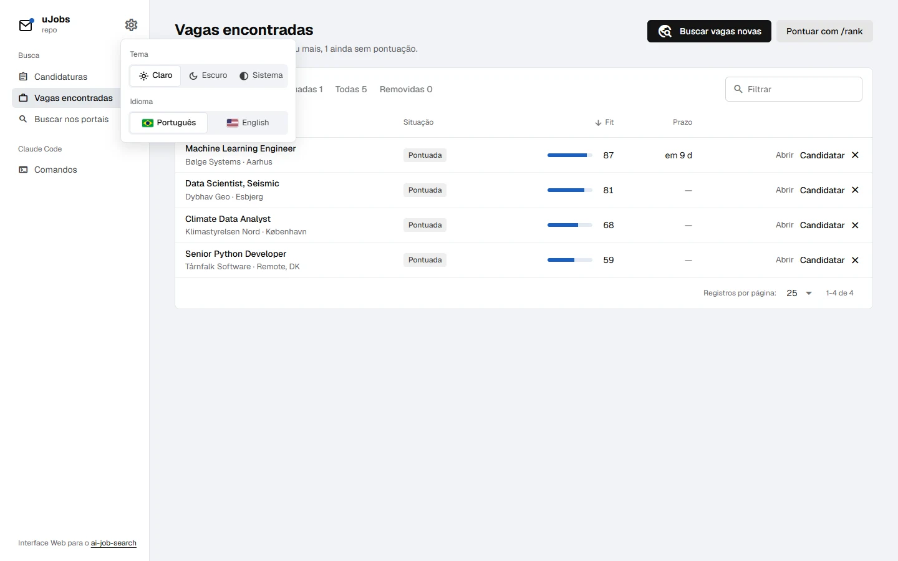
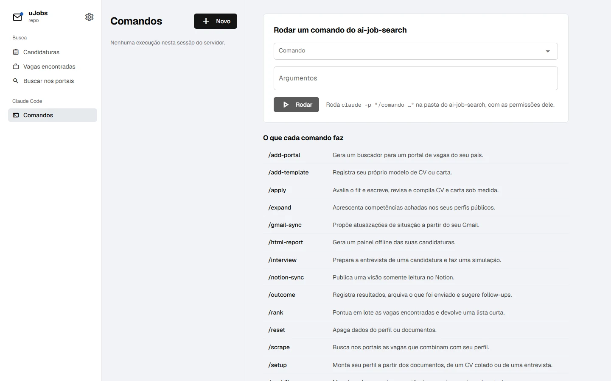
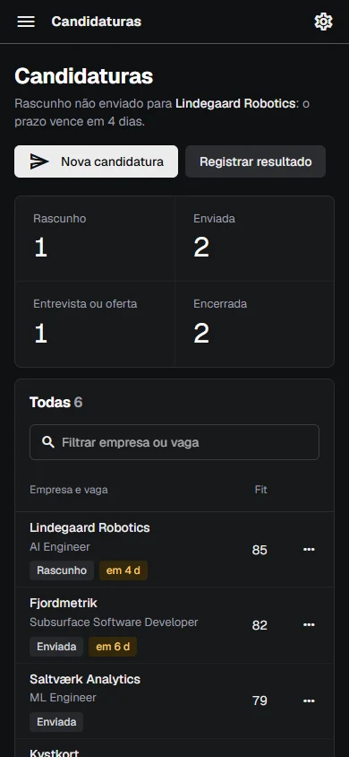

<p align="center">
  
</p>

<h1 align="center">uJobs</h1>

<p align="center">
  <a href="README.md">English</a> · <b>Português (Brasil)</b>
</p>

<p align="center">
  Interface web para o <a href="https://github.com/ai-job-search-dev/ai-job-search">ai-job-search</a>: suas candidaturas, as vagas que ele encontrou e os comandos dele no Claude Code, numa página local. Um único binário Go com o frontend dentro, que roda com Gin, Echo ou Chi, à sua escolha.
</p>

<p align="center">
  
  
  
  
  
  
  
</p>

<p align="center">
  
</p>

> [!NOTE]
> **O uJobs depende do ai-job-search e não faz o trabalho dele.** Buscar vagas, pontuar, escrever CV e carta: tudo isso acontece no ai-job-search, rodado pelo Claude Code. O uJobs lê os arquivos que ele grava e dispara os comandos dele. Sem uma pasta do ai-job-search, não há nada para mostrar. As capturas usam empresas de exemplo, inventadas.

## Recursos

- **Candidaturas**: cada linha do `job_search_tracker.csv`, com quantas estão em cada etapa, o fit em barra, prazos da próxima semana destacados, links para CV, carta e vaga, e atalhos para `/interview` e `/outcome`. A linha sob o título diz o que precisa de você primeiro (um rascunho não enviado com prazo perto).
- **Vagas encontradas**: o histórico de `/scrape` e `/rank` no `job_scraper/seen_jobs.json`, nas abas **Pontuadas**, **Não pontuadas**, **Todas** e **Removidas**, com o botão **Candidatar** que dispara o `/apply`.
- **Remover do painel**: esconde uma vaga sem apagar. Ela é marcada como `skipped`, a situação que o próprio ai-job-search usa para vagas descartadas, então o `/rank` ignora e o `/scrape` não traz de volta. Dá para desfazer na hora, ou restaurar pela aba **Removidas**.
- **Buscar nos portais**: uma busca direta em um portal instalado, pelos buscadores do próprio ai-job-search.
- **Comandos**: roda qualquer comando do ai-job-search (`/setup`, `/scrape`, `/apply <url>`…) com `claude -p`, e deixa você responder às perguntas do Claude na mesma sessão.
- **Configurações** (⚙ no topo): **tema claro, escuro ou do sistema** e **português ou inglês**, ambos lembrados.
- **Três backends, uma API**: `--router gin`, `--router echo` ou `--router chi`; a mesma bateria de testes roda nos três.

## Capturas

**Vagas encontradas** no tema escuro.

<p align="center"></p>

**Configurações**: tema e idioma.

<p align="center"></p>

**Comandos**: todos os comandos do ai-job-search e o que cada um faz.

<p align="center"></p>

**No celular**, a navegação vira um menu.

<p align="center"></p>

## Como começar

Você precisa de:

- uma **pasta do ai-job-search já configurada**, seguindo o [SETUP.md](https://github.com/ai-job-search-dev/ai-job-search/blob/main/SETUP.md) dele (Claude Code, Bun, Python e LaTeX);
- **Go 1.27+** e **Node 22+**, só para compilar.

```sh
git clone https://github.com/SamuelSchutz13/uJobsGUI.git
cd uJobsGUI

cd web && npm install && npm run build && cd ..
go build -o ujobs .

./ujobs --root /caminho/do/ai-job-search     # ou AI_JOB_SEARCH_DIR=/caminho/do/ai-job-search ./ujobs
```

Abra **http://127.0.0.1:8080**.

| Flag       | Padrão               | O que é                                      |
| ---------- | -------------------- | -------------------------------------------- |
| `--root`   | `$AI_JOB_SEARCH_DIR` | a pasta do ai-job-search                     |
| `--router` | `chi`                | `gin`, `echo` ou `chi`                       |
| `--addr`   | `127.0.0.1:8080`     | endereço de escuta; mantenha em loopback     |
| `--claude` | `claude`             | o executável do Claude Code                  |
| `--bun`    | `bun`                | o executável do Bun                          |

### Desenvolvimento

```sh
go run . --root ../ai-job-search     # API em :8080
cd web && npm run dev                # Quasar com hot reload, faz proxy de /api para :8080
go test ./...                        # as mesmas requisições no Gin, no Echo e no Chi
```

## Como funciona

```
navegador  →  app Quasar (embutido)  →  /api  →  Gin | Echo | Chi  →  internal/core
internal/core  →  job_search_tracker.csv, job_scraper/seen_jobs.json, cv/, cover_letters/
               →  bun run .agents/skills/<portal>/cli/src/cli.ts search …
               →  claude -p "/<comando> …"  (e --resume para as respostas)
```

- **Um núcleo, três roteadores.** Toda a lógica fica em `internal/core`, que não conhece framework HTTP nenhum. `gin.go`, `echo.go` e `chi.go` ligam as mesmas rotas a ele.
- **Nada reimplementado.** Os dados vêm dos arquivos que o ai-job-search grava; buscas e comandos rodam as ferramentas dele, na pasta dele, com as permissões do `.claude/settings.json` dele.
- **Escrita cuidadosa.** Remover uma vaga muda só o `status` daquela entrada e troca o arquivo de forma atômica, como o `rank_state.py` do ai-job-search faz.
- **Idiomas** ficam em `web/src/i18n.js`; trocar o idioma também troca os textos do próprio Quasar. Os erros do servidor chegam com um código (`unknown_command`, `portal_not_found`…) que a página mostra no seu idioma, com o inglês como reserva. **Tema e idioma** ficam lembrados no navegador.

### Segurança

O uJobs dispara o Claude Code com acesso aos seus dados pessoais, por isso:

- por padrão ele escuta só em `127.0.0.1`. **Não exponha na rede.**
- requisições com `Host` que não seja loopback são recusadas (DNS rebinding), e escritas exigem `application/json`, então outro site não consegue disparar comandos pelo seu navegador;
- só roda comandos que existem em `.claude/commands` e `.claude/skills` da pasta;
- `/files` só serve `cv/`, `cover_letters/` e `documents/applications/`.

### Estrutura do projeto

```
main.go                   flags e inicialização
internal/
  core/core.go            lê a pasta do ai-job-search e roda as ferramentas dele (sem framework)
  api/api.go              rotas, erros e segurança compartilhados por todos os roteadores
  api/gin.go              adaptador Gin
  api/echo.go             adaptador Echo
  api/chi.go              adaptador Chi
  api/api_test.go         as mesmas requisições nos três
web/
  embed.go                embute dist/spa no binário
  public/favicon.svg      ícone da aba do navegador
  src/i18n.js             textos em português e inglês
  src/Settings.vue        menu de tema e idioma
  src/app.css             tokens dos temas claro e escuro
  src/pages/              Candidaturas, Vagas encontradas, Buscar, Comandos
```

## Limitações conhecidas

- **A resposta do Claude chega no fim.** Não há progresso ao vivo enquanto um comando roda; o `/apply` pode levar alguns minutos.
- **As execuções ficam na memória.** Reiniciar o servidor esquece a lista de Comandos (os arquivos que o ai-job-search gravou continuam lá).
- **Restaurar** não sabe a situação que a vaga tinha antes de ser removida: uma vaga pontuada volta para Pontuadas, as outras para a fila do `/rank`. O **Desfazer**, logo depois de remover, volta exatamente como estava.
- Os portais que vêm com o ai-job-search são quase todos dinamarqueses, mais LinkedIn e Freehire. Use o `/add-portal` do ai-job-search para adicionar um do seu país.

## Créditos

- [ai-job-search](https://github.com/ai-job-search-dev/ai-job-search), dos autores dele (MIT), que faz todo o trabalho de verdade da busca de emprego. Se ele te ajudou, apoie pelo link no README dele.
- Fonte: [Geist](https://vercel.com/font) (SIL Open Font License), carregada do Google Fonts.
- Ícones: [Material Icons](https://fonts.google.com/icons) (Apache 2.0), via `@quasar/extras`.
- Visual: o estilo "achromatic ledger" do [taste-skill](https://github.com/Leonxlnx/taste-skill).

O uJobs é um projeto independente da comunidade, sem afiliação com o ai-job-search nem com a Anthropic. Licença MIT.
